[English](README.md) · [Українська](README.uk.md) · [Русский](README.ru.md)

🌐 All our programs: https://drugoj00.github.io/

Description and screenshots: https://drugoj00.github.io/phone-in-window-with-sound/adb-droiddesk.html

# ADB DroidDesk

Android and Android TV from your PC: install any app, adapt apps for a TV box, and Long Scissors for screenshots and video.

A free Windows program for phones, tablets and Android TV boxes over USB and Wi-Fi. The focus is Android TV: put anything on a box without a file manager, switch on accessibility services where the system blocks them, adapt a phone app for TV, make a banner. Plus Long Scissors: screenshots (long pages too), video and GIF recording, an editor and text from a shot. The rest is in one window: screen with sound, apps, files, adb console, cleaner, backups. adb and scrcpy are inside, nothing else to install.

⭐ If the program is useful, please star this repository: it costs nothing and helps other people find it.

## Download

**Version 2.0.** [ADBDroidDesk-2.0.exe](https://github.com/drugoj00/adb-droiddesk/releases/latest) (Assets) · [Releases](https://github.com/drugoj00/adb-droiddesk/releases)

SHA-256: `203d6f81af445203ef6f6e582f97a3ce3ca83d3ac733c42a8f9d4be1f7e79772`

## What's new in 2.0

- Long Scissors built in: screenshots, long pages, video and GIF, editor, text from a shot, history.
- “This computer” tab: details of the Windows PC.

## Features

### Android TV

- Install on a box without a file manager: APK, APKS, APKM, XAPK, ZIP with game data (OBB).
- Sources: files, a folder, drag and drop, F-Droid with all old versions, a link to a file.
- The right package parts are chosen for the device CPU, screen density and language.
- Install an older version over a newer one; where Android 12+ refuses, a replace with a backup and rollback (data is deleted).
- Old apps on Android 14: bypass of the “target SDK too old” block.
- Accessibility: enable a service and “restricted settings” with adb commands (Android 13–14).
- Adapt for TV: Android TV launcher entry, no touchscreen requirement, 64-bit libraries from another build, signing.
- Banners 320×180, 640×360, 1280×720; icon and cover images from Google Play.
- Remote: arrows, OK, Back, Home, volume, text input; to several devices at once.

### Long Scissors

- Area, window, whole screen and a long page with auto-scroll.
- Video with sound and GIFs with a size limit.
- Editor, “Pretty”, text from a shot (OCR), history with search, joining and converting.
- A click on the tray icon captures at once; Ctrl+Shift+S opens the panel.

### Everything else

- Device screen in a tab: sound (Android 10 too), video recording, screenshot, rotation, a mini window in the screen corner.
- Apps: names and icons, uninstall and disable system apps with an APK copy, permissions, batch actions.
- Files: internal storage and card, drag and drop both ways.
- adb console with highlighting and history, logcat with filters.
- Cleaner with a database of known bloatware and rollback; app backups.
- Device overview like CPU-Z: CPU, memory, battery, display, cameras, sensors; a “This computer” tab does the same for the Windows PC itself.
- Several devices at once, USB and Wi-Fi, pairing by code; tray icon; Russian, Ukrainian, English; light and dark theme.

## Screenshots

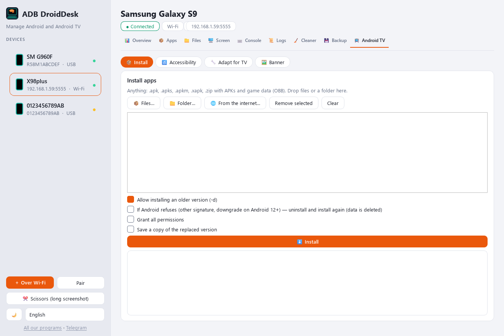

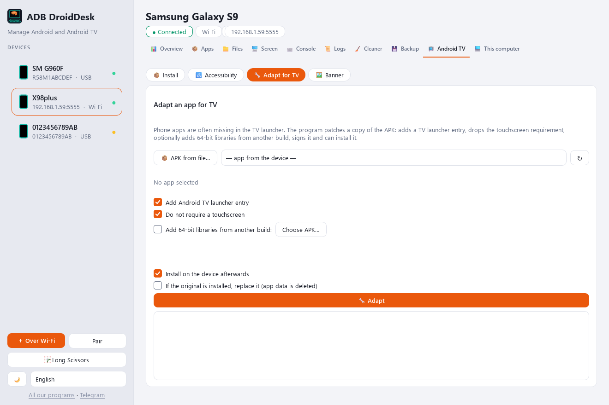

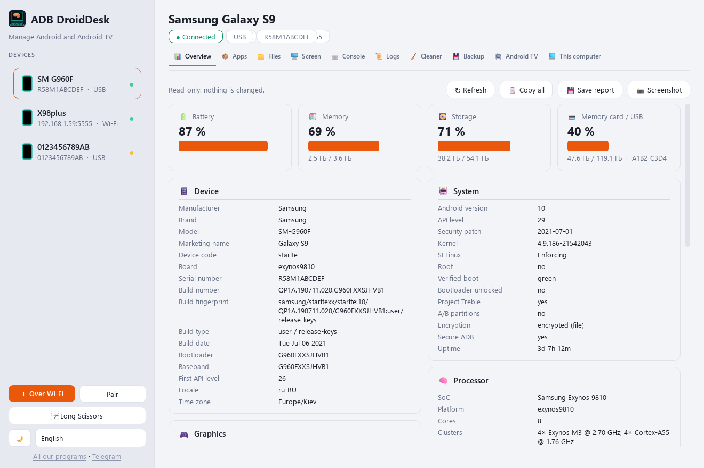

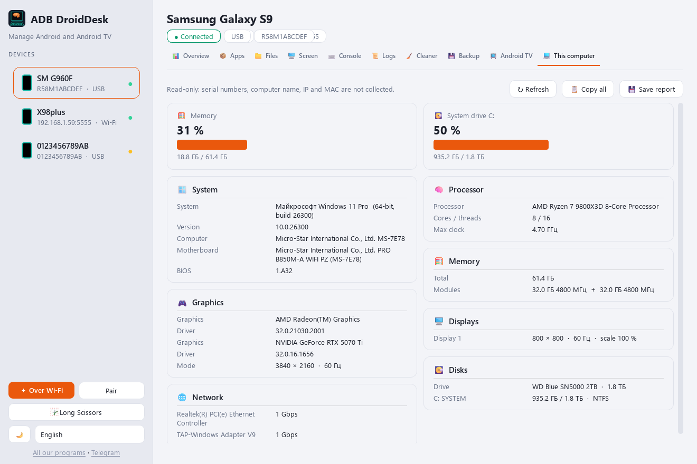

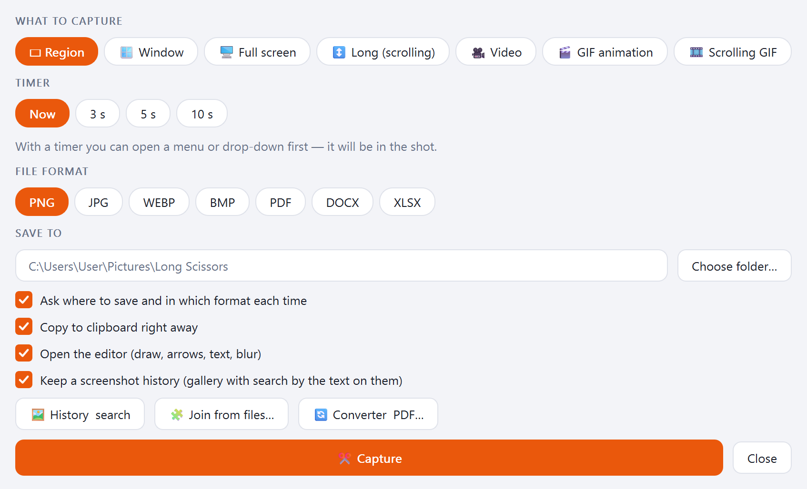

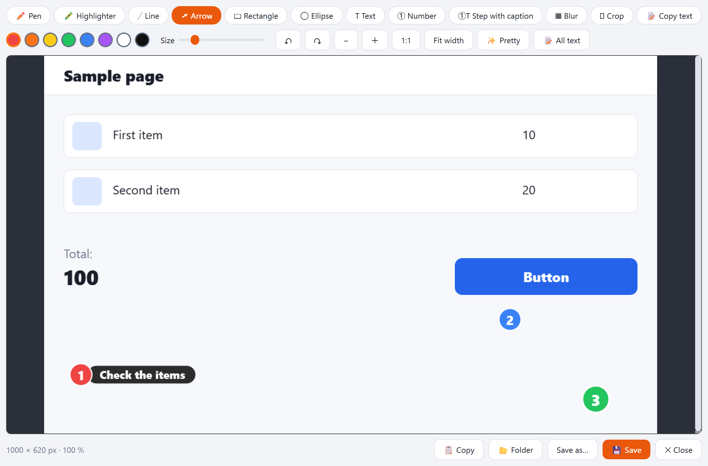

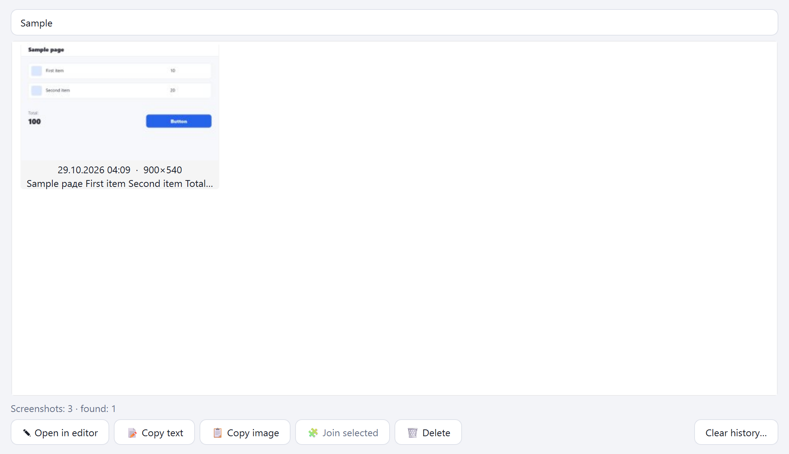

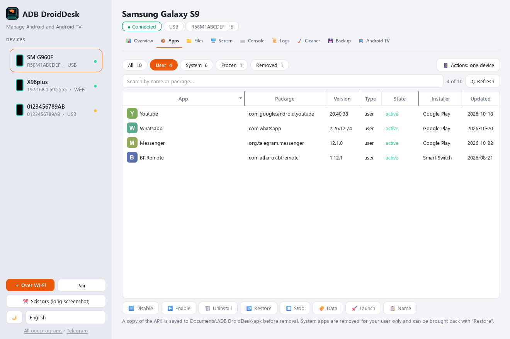

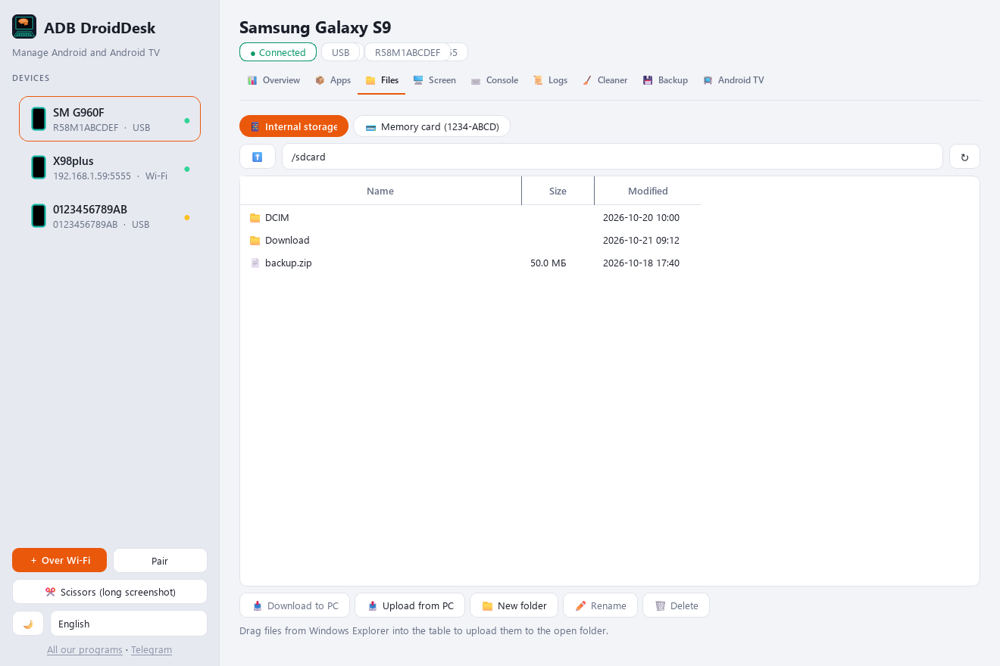

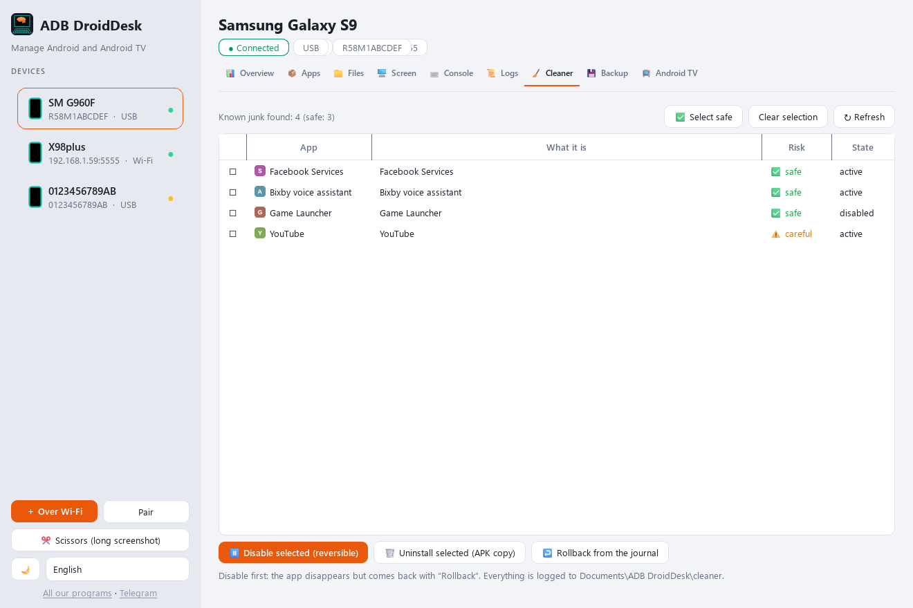

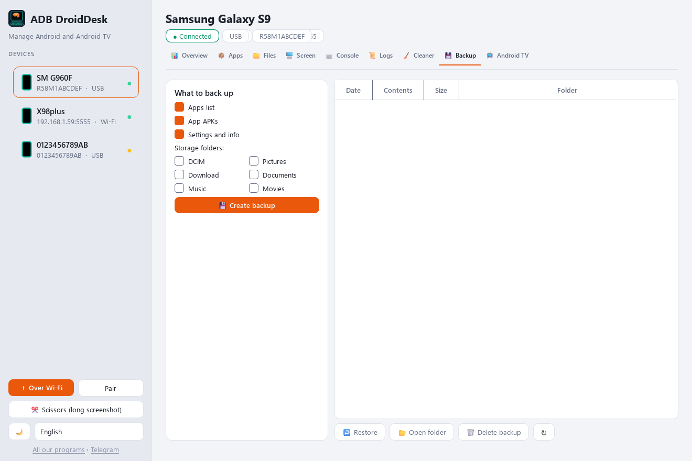

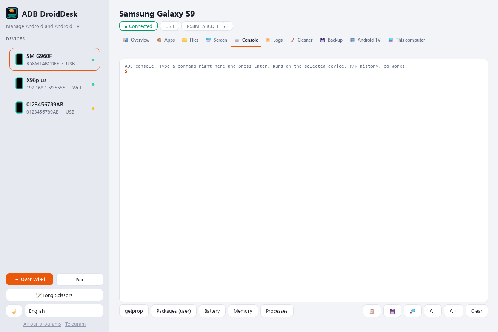

## Requirements

Windows 10 or 11 (64-bit); an Android phone or box with debugging on (USB or network). Administrator rights are optional; the internet is needed only for F-Droid and Google Play search.

## Quick start

1. Download ADBDroidDesk-2.0.exe and run it; Windows asks for permission (if declined, the program goes into your user folder).
2. On the device: Developer options → USB debugging (a box: network debugging); connect the cable and allow debugging.
3. A box over Wi-Fi: “+ Wi-Fi” → IP and port, usually 5555.
4. Android TV → Install: drop app files into the window and press Install.

## Limits

- Any version can be downloaded from F-Droid; Google Play is used only for banner images, not for downloading apps.
- A downgrade on Android 12+ and a signature change are possible only by deleting the app data: the system allows nothing else.
- Adapting for TV changes the app signature: store updates will not apply to the copy; split apps are not supported yet; remote control cannot be added to an app.
- Tested on Android 10 and 15 phones; accessibility services have not been tested on a real Android TV 14 box yet.
- Android 10 sound goes through sndcpy; Android 11+ sends sound by itself.
- The installer is not signed with a publisher certificate: Windows may show a SmartScreen warning (“More info” → “Run anyway”).
- The program is unofficial; adb (Google) and scrcpy (Genymobile) are inside, Apache-2.0.
