[English](README.md) · [Українська](README.uk.md) · [Русский](README.ru.md)

🌐 Все наши программы: https://drugoj00.github.io/

Описание и скриншоты: https://drugoj00.github.io/phone-in-window-with-sound/adb-droiddesk.html

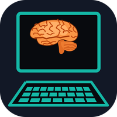

# ADB DroidDesk

Android и Android TV с компьютера: установка любых приложений, подстройка под приставку, «Длинные ножницы» для скриншотов и видео.

Бесплатная программа для Windows для телефонов, планшетов и приставок Android TV по USB и Wi-Fi. Упор на Android TV: поставить на приставку что угодно без файлового менеджера, включить службы специальных возможностей там, где их блокирует система, подстроить телефонное приложение под ТВ, сделать баннер. Плюс «Длинные ножницы»: скриншоты (в том числе длинной страницы), запись видео и GIF, редактор и текст со снимка. Остальное — в одном окне: экран с звуком, приложения, файлы, консоль adb, очистка, копии. adb и scrcpy внутри, ничего ставить отдельно не нужно.

⭐ Если программа полезна, поставьте звезду этому репозиторию: это бесплатно и помогает другим её найти.

## Скачать

**Версия 3.0.** [ADBDroidDesk-3.0.exe](https://github.com/drugoj00/adb-droiddesk/releases/latest) (Assets) · [Releases](https://github.com/drugoj00/adb-droiddesk/releases)

SHA-256: `f178316c9078d022b54fe239e97d6df442bedacea9fd7e3a2977dc80212b5da0`

## Что нового в 3.0

- Вкладка «Связь»: устройства по интернету через Tailscale, подключение по ADB, проверка канала, файл (Taildrop).
- Видеозвонок без браузера: выбор человека, «Звонит… Ответить / Отклонить», кнопки звука, динамика и камеры.
- Мастер настройки Tailscale на ПК и на Android-устройстве.
- Приглашения по коду программы: подключить человека к своей сети и принять приглашение.
- Экран другого компьютера и «Доступ к этому экрану».
- Файлы: две панели, копирование, перенос и удаление между ПК, устройством и другим компьютером.
- Автоподключение знакомых устройств по домашней сети и через Tailscale.
- Обновление программы из GitHub: проверка выпусков и установка поверх.
- Исправлено: второй значок на Samsung после установки APK.

## Возможности

### Android TV

- Установка на приставку без файлового менеджера: APK, APKS, APKM, XAPK, ZIP с данными игры (OBB).
- Источники: файлы, папка, перетаскивание, F-Droid со всеми старыми версиями, ссылка на файл.
- Нужные части пакета выбираются под процессор, плотность экрана и язык устройства.
- Установка более старой версии поверх новой; где Android 12+ не даёт, замена с копией и откатом (данные удаляются).
- Старые приложения на Android 14: обход блокировки «слишком старый SDK».
- Специальные возможности: включить службу и «ограниченные настройки» командами adb (Android 13–14).
- Подстройка под ТВ: запуск с экрана Android TV, без требования сенсорного экрана, 64-бит библиотеки из другой сборки, подпись.
- Баннеры 320×180, 640×360, 1280×720; значок и обложки из Google Play.
- Пульт: стрелки, OK, Назад, Домой, громкость, ввод текста; на несколько устройств сразу.

### Длинные ножницы

- Область, окно, весь экран и длинная страница с автопрокруткой.
- Запись видео со звуком и GIF с лимитом размера.
- Редактор, «Красиво», текст со снимка (OCR), история с поиском, склейка и конвертер.
- Щелчок по значку в трее сразу снимает; Ctrl+Shift+S открывает панель.

### Связь по интернету

- Вкладка «Связь»: устройства сети Tailscale, канал (прямой или через ретранслятор), подключение по ADB, проверка канала.
- Мастер: Tailscale на ПК и на Android-устройстве, вход по ключу; отправка файла (Taildrop).
- Приглашения по коду программы: подключить человека к своей сети, принять приглашение; ключи одноразовые, на час.
- Видеозвонок без браузера: звонок человеку из списка, окно «Звонит…», звук, динамик и камера включаются кнопками.
- Экран другого компьютера и «Доступ к этому экрану»; файлы другого компьютера во вкладке «Файлы».
- Автоподключение знакомых устройств по домашней сети и через Tailscale.

### Всё остальное

- Экран устройства во вкладке: звук (Android 10 тоже), запись видео, снимок, поворот, мини-окно в углу экрана.
- Приложения: названия и значки, удаление и отключение системных с копией APK, разрешения, пакетные действия.
- Файлы: две панели (ПК, устройство, другой компьютер), копирование, перенос, удаление, перетаскивание.
- Консоль adb с подсветкой и историей, logcat с фильтрами.
- Очистка по базе известных ненужных приложений с откатом; резервные копии приложений.
- Обзор устройства как в CPU-Z: процессор, память, батарея, экран, камеры, датчики; вкладка «Этот компьютер» — то же для самого Windows-компьютера.
- Несколько устройств сразу, USB и Wi-Fi, сопряжение по коду; значок у часов; русский, украинский, английский; светлая и тёмная тема.

## Скриншоты

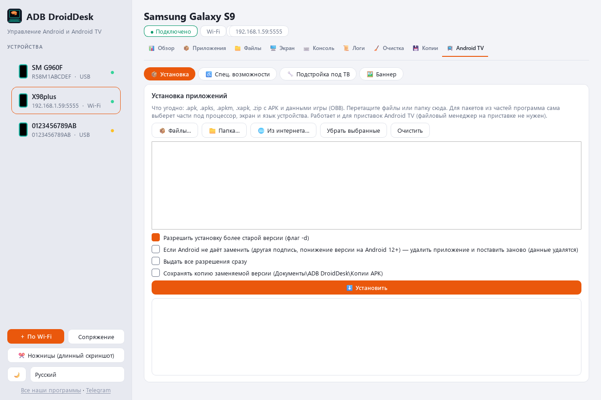

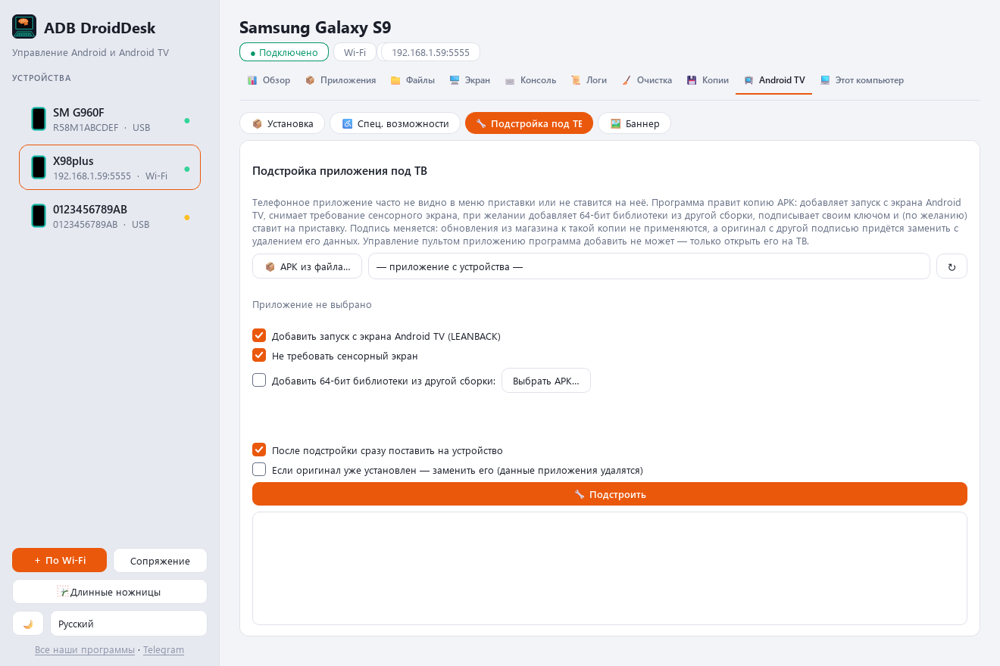

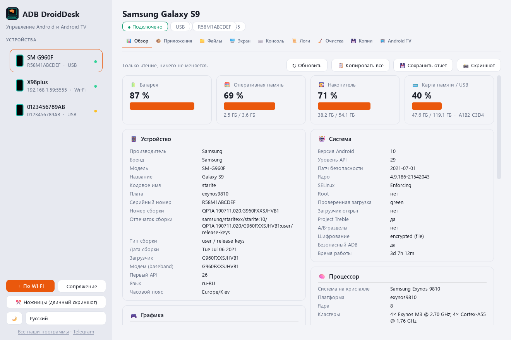

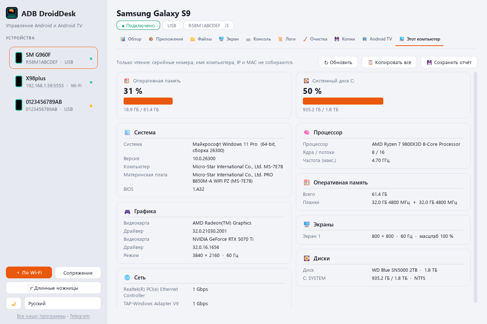

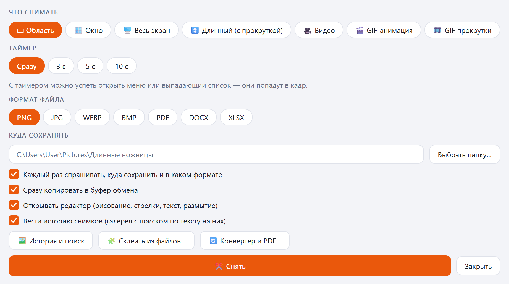

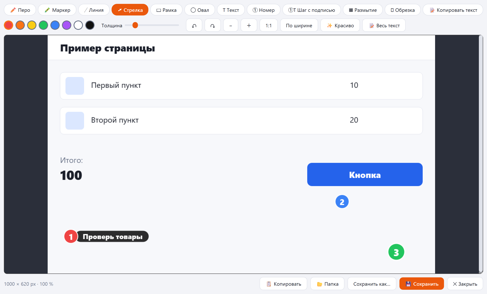

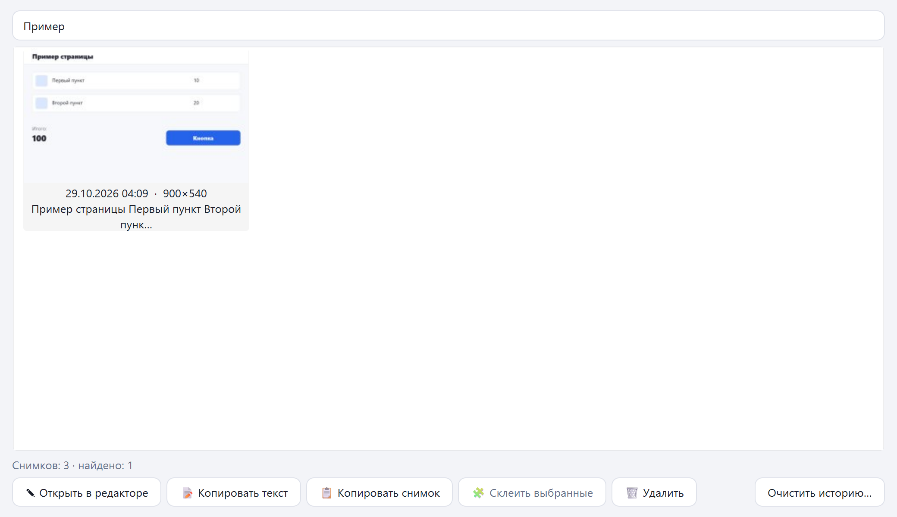

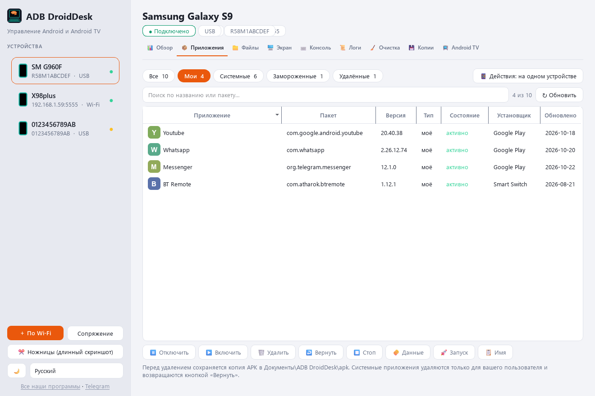

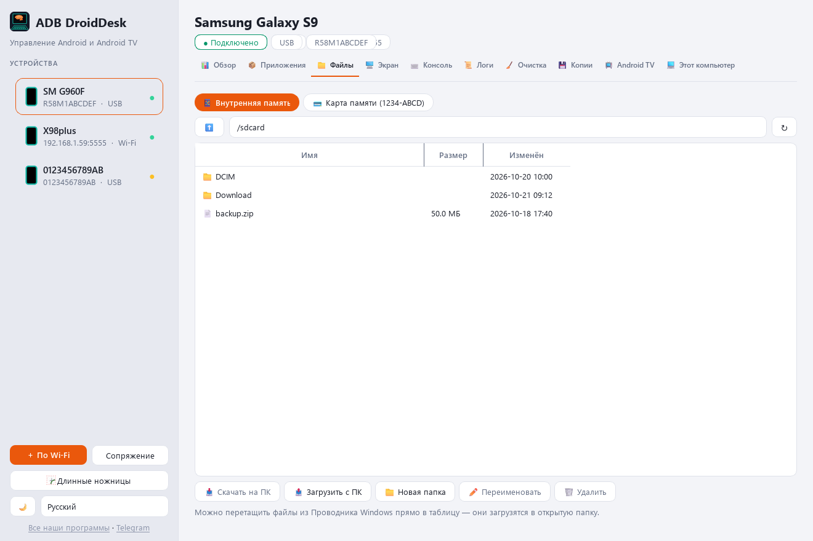

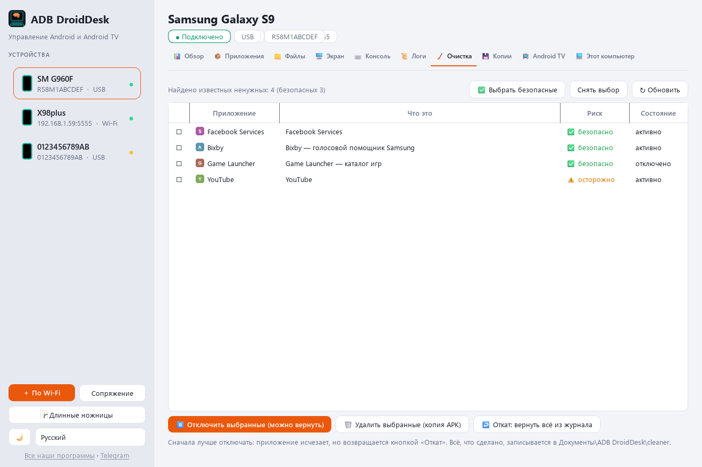

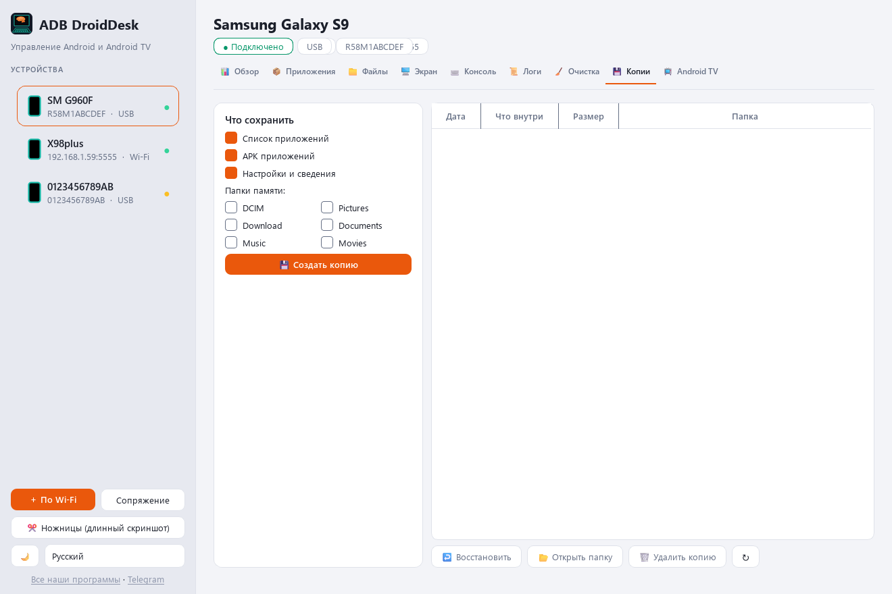

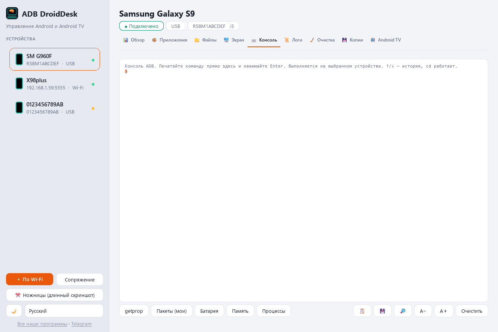

## Требования

Windows 10 или 11 (64-бит); телефон или приставка Android с включённой отладкой (по USB или по сети). Права администратора не обязательны, интернет нужен для поиска в F-Droid и Google Play, связи по интернету и обновления.

## Быстрый старт

1. Скачайте ADBDroidDesk-3.0.exe и запустите; Windows спросит разрешение (при отказе программа встанет в папку пользователя).
2. На устройстве: «Для разработчиков» → «Отладка по USB» (приставка: «Отладка по сети»); подключите кабель и разрешите отладку.
3. Приставка по Wi-Fi: «+ По Wi-Fi» → IP и порт, обычно 5555.
4. Android TV → «Установка»: перетащите файлы приложений в окно и нажмите «Установить».

## Ограничения

- Скачать из F-Droid можно любую версию; Google Play используется только для картинок баннера, не для скачивания приложений.
- Понижение версии на Android 12 и новее и смена подписи возможны только с удалением данных приложения: система не даёт иначе.
- Подстройка под ТВ меняет подпись приложения: обновления из магазина к такой копии не придут; приложения из нескольких частей пока не поддерживаются; управление пультом приложению добавить нельзя.
- Проверено на телефонах Android 10 и 15; на реальной приставке Android TV 14 службы специальных возможностей пока не проверялись.
- Звук Android 10 идёт через sndcpy; Android 11 и новее передают звук сами.
- Установщик не подписан сертификатом издателя: Windows может показать предупреждение SmartScreen («Подробнее» → «Всё равно выполнить»).
- Программа неофициальная; внутри adb (Google) и scrcpy (Genymobile), лицензия Apache-2.0.
- Видеозвонок идёт напрямую между устройствами (нужен Tailscale на обоих или одна сеть, ретранслятора нет) и использует WebView2 из Windows 10 и 11.
