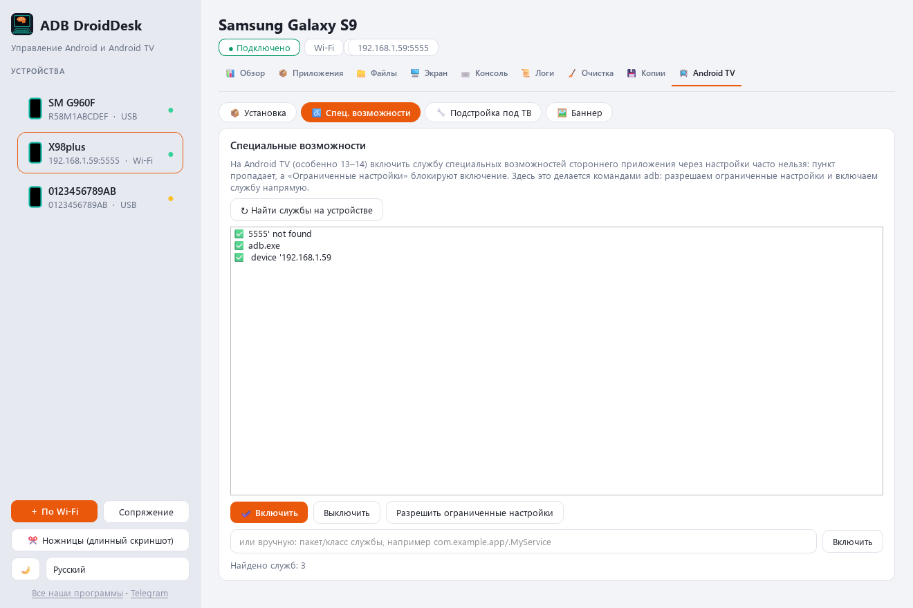
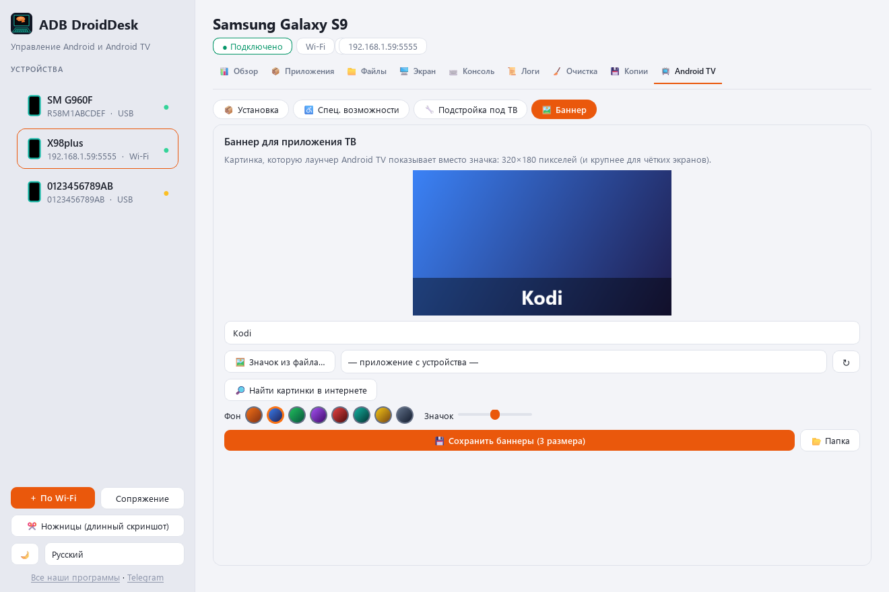
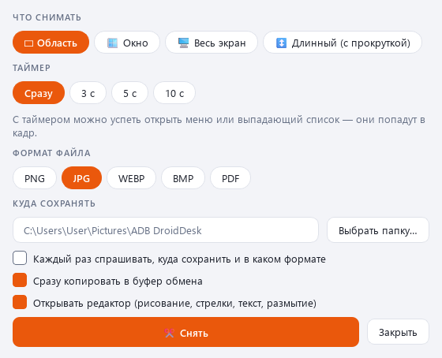

[English](README.md) · [Українська](README.uk.md) · [Русский](README.ru.md)

🌐 Все наши программы: https://drugoj00.github.io/

Описание и скриншоты: https://drugoj00.github.io/phone-in-window-with-sound/adb-droiddesk.html

# ADB DroidDesk

Android и Android TV с компьютера: установка любых приложений, подстройка под приставку, «Ножницы» с длинным скриншотом.

Бесплатная программа для Windows для телефонов, планшетов и приставок Android TV по USB и Wi-Fi. Упор на Android TV: поставить на приставку что угодно без файлового менеджера, включить службы специальных возможностей там, где их блокирует система, подстроить телефонное приложение под ТВ, сделать баннер. Отдельно «Ножницы»: обычный и длинный скриншот с прокруткой и свой редактор. Остальное — в одном окне: экран с звуком, приложения, файлы, консоль adb, очистка, копии. adb и scrcpy внутри, ничего ставить отдельно не нужно.

⭐ Если программа полезна, поставьте звезду этому репозиторию: это бесплатно и помогает другим её найти.

## Скачать

**Версия 1.0.** [ADBDroidDesk-1.0.exe](https://github.com/drugoj00/adb-droiddesk/releases/latest) (Assets) · [Releases](https://github.com/drugoj00/adb-droiddesk/releases)

SHA-256: `08300ea25bf4a365c5f734bf2d64a2dc6a933cdc988dfcb5cc38427d38aa0950`

## Что нового в 1.0

- Первая публичная версия: всё перечисленное выше.

## Возможности

### Android TV

- Установка на приставку без файлового менеджера: APK, APKS, APKM, XAPK, ZIP с данными игры (OBB).
- Источники: файлы, папка, перетаскивание, F-Droid со всеми старыми версиями, ссылка на файл.
- Нужные части пакета выбираются под процессор, плотность экрана и язык устройства.
- Установка более старой версии поверх новой; где Android 12+ не даёт, замена с копией и откатом (данные удаляются).
- Старые приложения на Android 14: обход блокировки «слишком старый SDK».
- Специальные возможности: включить службу и «ограниченные настройки» командами adb (Android 13–14).
- Подстройка под ТВ: запуск с экрана Android TV, без требования сенсорного экрана, 64-бит библиотеки из другой сборки, подпись.
- Баннеры 320×180, 640×360, 1280×720; значок и обложки из Google Play.
- Пульт: стрелки, OK, Назад, Домой, громкость, ввод текста; на несколько устройств сразу.

### Ножницы

- Скриншот области, окна, всего экрана и длинный: с прокруткой вниз и вправо.
- Таймер до 10 с, чтобы успеть открыть меню; формат PNG, JPG, WEBP, BMP, PDF.
- Встроенный редактор: рисование, стрелки, текст, размытие; копия в буфер обмена.
- Запуск отдельным ярлыком, без главного окна.

### Всё остальное

- Экран устройства во вкладке: звук (Android 10 тоже), запись видео, снимок, поворот, мини-окно в углу экрана.
- Приложения: названия и значки, удаление и отключение системных с копией APK, разрешения, пакетные действия.
- Файлы: внутренняя память и карта, перетаскивание в обе стороны.
- Консоль adb с подсветкой и историей, logcat с фильтрами.
- Очистка по базе известных ненужных приложений с откатом; резервные копии приложений.
- Обзор устройства как в CPU-Z: процессор, память, батарея, экран, камеры, датчики.
- Несколько устройств сразу, USB и Wi-Fi, сопряжение по коду; значок у часов; русский, украинский, английский; светлая и тёмная тема.

## Скриншоты

## Требования

Windows 10 или 11 (64-бит); телефон или приставка Android с включённой отладкой (по USB или по сети). Права администратора не обязательны, интернет нужен только для поиска в F-Droid и Google Play.

## Быстрый старт

1. Скачайте ADBDroidDesk-1.0.exe и запустите; Windows спросит разрешение (при отказе программа встанет в папку пользователя).
2. На устройстве: «Для разработчиков» → «Отладка по USB» (приставка: «Отладка по сети»); подключите кабель и разрешите отладку.
3. Приставка по Wi-Fi: «+ По Wi-Fi» → IP и порт, обычно 5555.
4. Android TV → «Установка»: перетащите файлы приложений в окно и нажмите «Установить».

## Ограничения

- Скачать из F-Droid можно любую версию; Google Play используется только для картинок баннера, не для скачивания приложений.
- Понижение версии на Android 12 и новее и смена подписи возможны только с удалением данных приложения: система не даёт иначе.
- Подстройка под ТВ меняет подпись приложения: обновления из магазина к такой копии не придут; приложения из нескольких частей пока не поддерживаются; управление пультом приложению добавить нельзя.
- Проверено на телефонах Android 10 и 15; на реальной приставке Android TV 14 службы специальных возможностей пока не проверялись.
- Звук Android 10 идёт через sndcpy; Android 11 и новее передают звук сами.
- Установщик не подписан сертификатом издателя: Windows может показать предупреждение SmartScreen («Подробнее» → «Всё равно выполнить»).
- Программа неофициальная; внутри adb (Google) и scrcpy (Genymobile), лицензия Apache-2.0.
