[English](README.md) · [Українська](README.uk.md) · [Русский](README.ru.md)

🌐 Усі наші програми: https://drugoj00.github.io/

Опис і скриншоти: https://drugoj00.github.io/phone-in-window-with-sound/adb-droiddesk.html

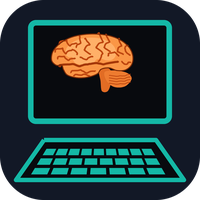

# ADB DroidDesk

Android і Android TV з комп’ютера: встановлення будь-яких застосунків, підлаштування під приставку, «Довгі ножиці» для скриншотів і відео.

Безкоштовна програма для Windows для телефонів, планшетів і приставок Android TV по USB та Wi-Fi. Упор на Android TV: поставити на приставку будь-що без файлового менеджера, увімкнути служби спеціальних можливостей там, де їх блокує система, підлаштувати телефонний застосунок під ТВ, зробити банер. Плюс «Довгі ножиці»: скриншоти (зокрема довгої сторінки), запис відео та GIF, редактор і текст зі знімка. Решта — в одному вікні: екран зі звуком, застосунки, файли, консоль adb, очищення, копії. adb і scrcpy всередині, нічого окремо ставити не треба.

⭐ Якщо програма корисна, поставте зірку цьому репозиторію: це безкоштовно й допомагає іншим її знайти.

## Завантажити

**Версія 2.0.** [ADBDroidDesk-2.0.exe](https://github.com/drugoj00/adb-droiddesk/releases/latest) (Assets) · [Releases](https://github.com/drugoj00/adb-droiddesk/releases)

SHA-256: `b6f8ba3738d1c2fc5e4d45be06840c6f69410994e0b5044746212f9e11292d1e`

## Що нового в 2.0

- Вбудовано «Довгі ножиці»: скриншоти, довга сторінка, відео та GIF, редактор, текст зі знімка, історія.
- Вкладка «Цей комп’ютер»: відомості про Windows-комп’ютер.

## Можливості

### Android TV

- Встановлення на приставку без файлового менеджера: APK, APKS, APKM, XAPK, ZIP з даними гри (OBB).
- Джерела: файли, тека, перетягування, F-Droid з усіма старими версіями, посилання на файл.
- Потрібні частини пакета добираються під процесор, щільність екрана та мову пристрою.
- Встановлення старішої версії поверх новішої; де Android 12+ не дозволяє, заміна з копією та відкатом (дані видаляються).
- Старі застосунки на Android 14: обхід блокування «надто старий SDK».
- Спеціальні можливості: увімкнути службу та «обмежені налаштування» командами adb (Android 13–14).
- Підлаштування під ТВ: запуск з екрана Android TV, без вимоги сенсорного екрана, 64-біт бібліотеки з іншої збірки, підпис.
- Банери 320×180, 640×360, 1280×720; значок і обкладинки з Google Play.
- Пульт: стрілки, OK, Назад, Додому, гучність, введення тексту; на кілька пристроїв одразу.

### Довгі ножиці

- Область, вікно, весь екран і довга сторінка з автопрокруткою.
- Запис відео зі звуком і GIF з лімітом розміру.
- Редактор, «Гарно», текст зі знімка (OCR), історія з пошуком, склеювання та конвертер.
- Клацання по значку в треї одразу знімає; Ctrl+Shift+S відкриває панель.

### Усе інше

- Екран пристрою у вкладці: звук (Android 10 теж), запис відео, знімок, поворот, міні-вікно в кутку екрана.
- Застосунки: назви й значки, видалення та вимкнення системних з копією APK, дозволи, пакетні дії.
- Файли: внутрішня пам’ять і картка, перетягування в обидва боки.
- Консоль adb з підсвічуванням та історією, logcat з фільтрами.
- Очищення за базою відомих непотрібних застосунків з відкатом; резервні копії застосунків.
- Огляд пристрою як у CPU-Z: процесор, пам’ять, батарея, екран, камери, датчики; вкладка «Цей комп’ютер» — те саме для самого Windows-комп’ютера.
- Кілька пристроїв одразу, USB і Wi-Fi, сполучення за кодом; значок біля годинника; українська, російська, англійська; світла й темна тема.

## Скриншоти

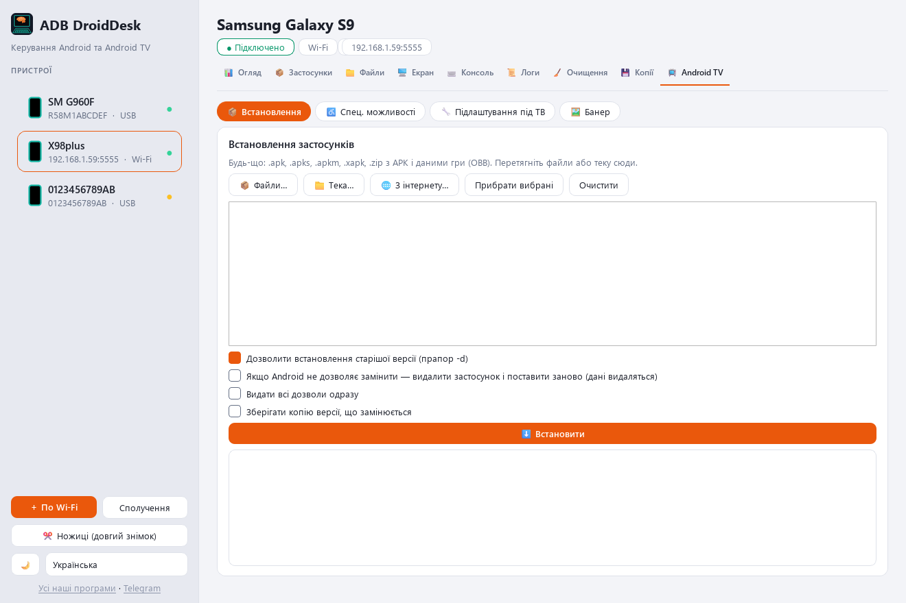

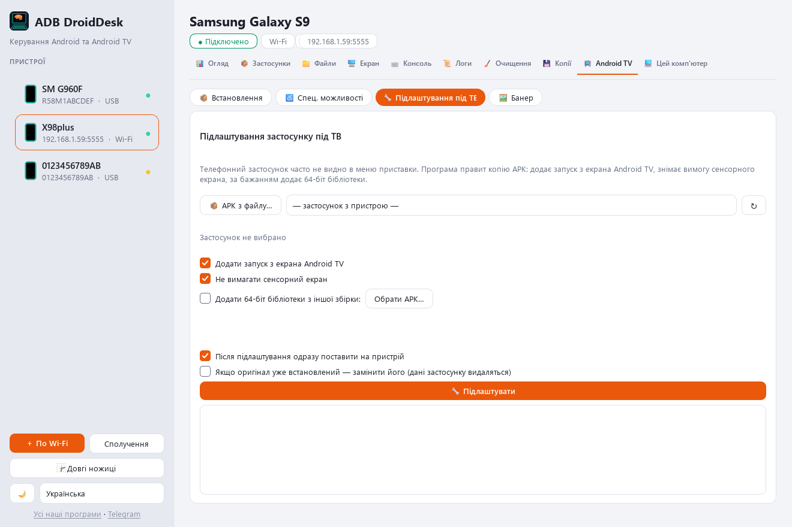

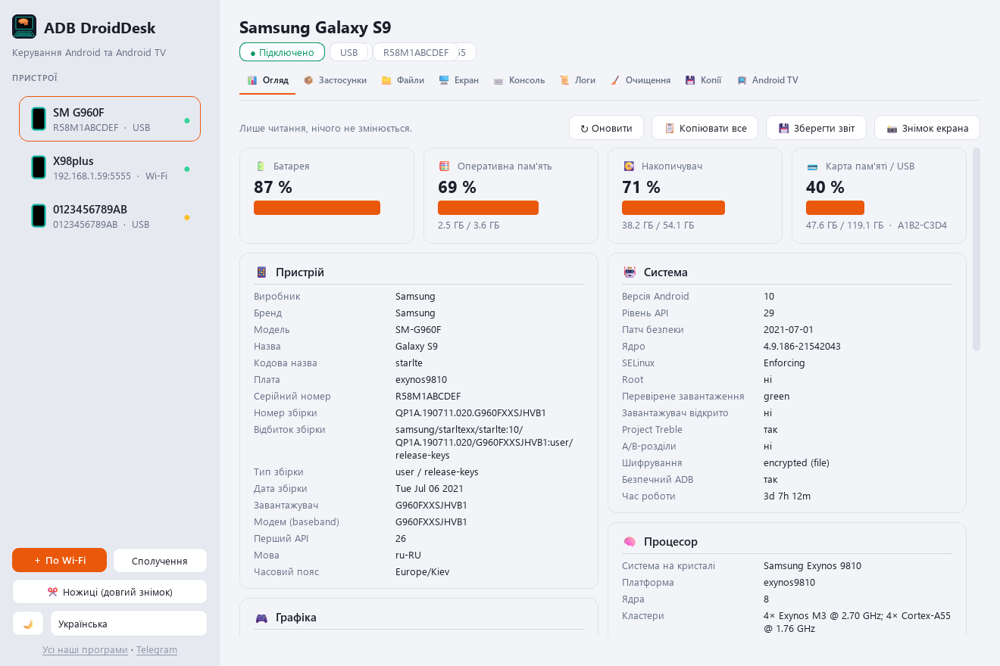

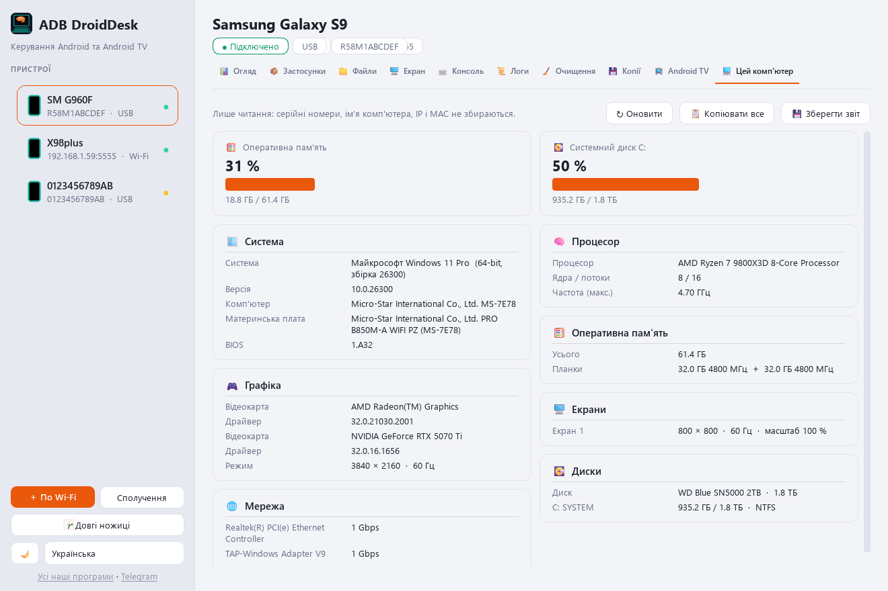

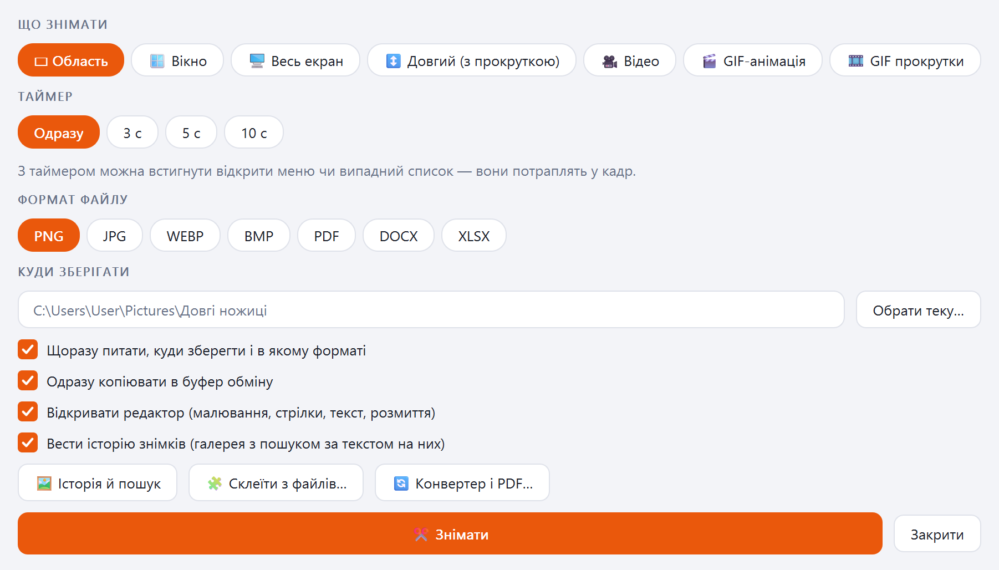

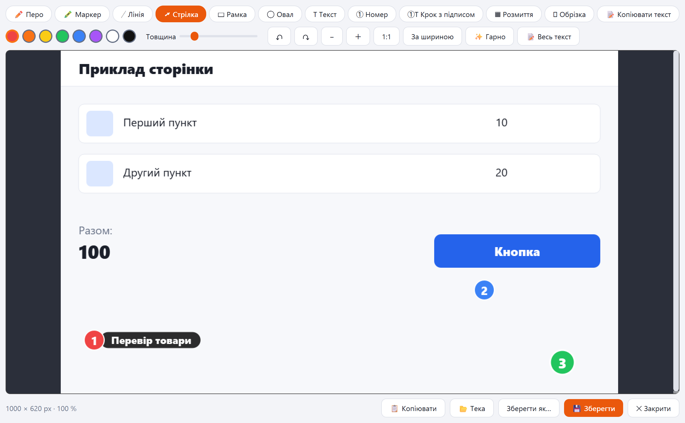

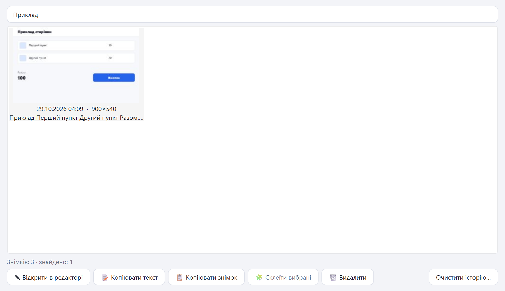

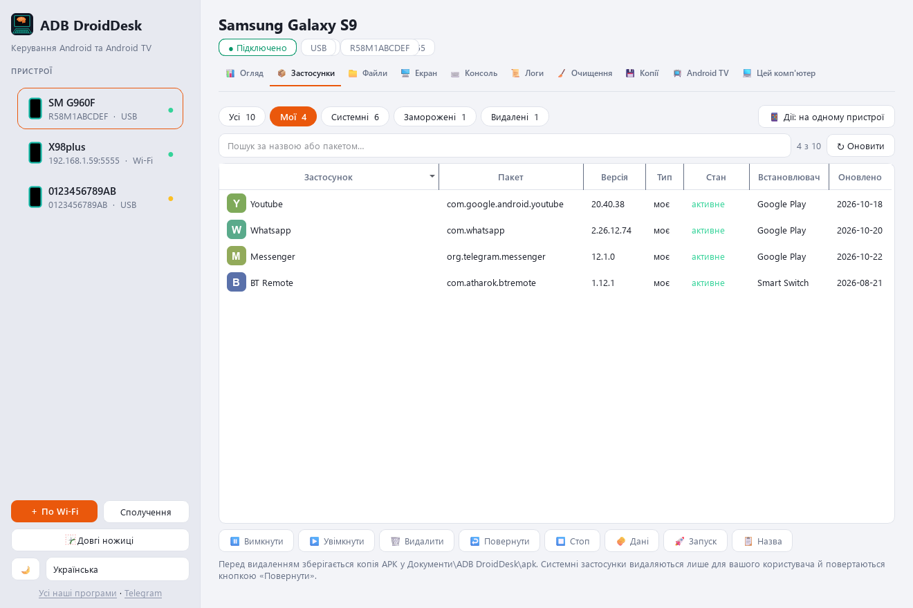

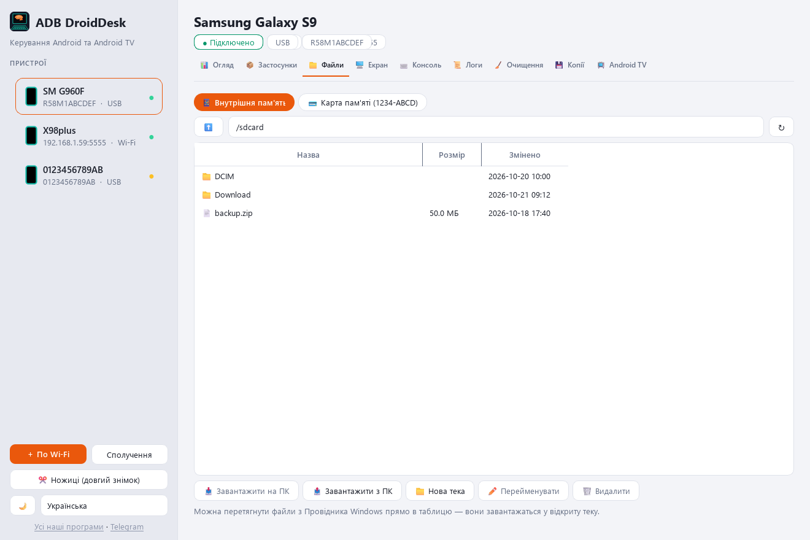

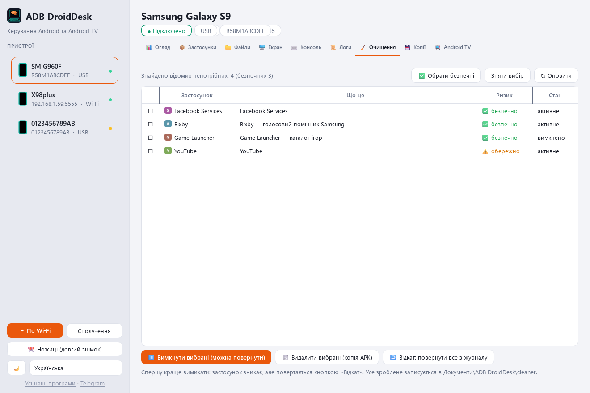

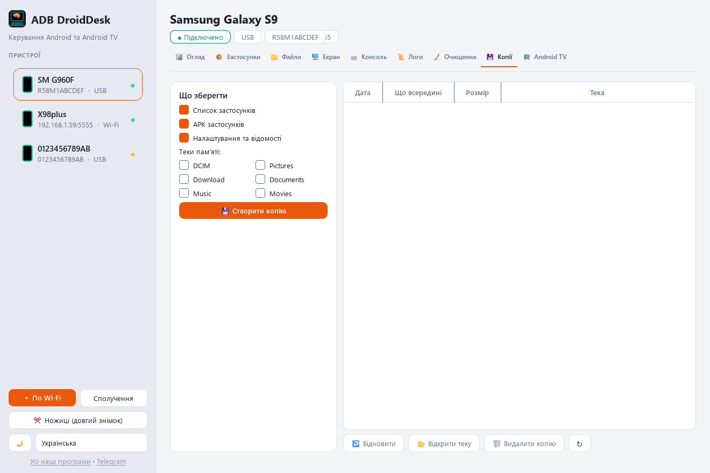

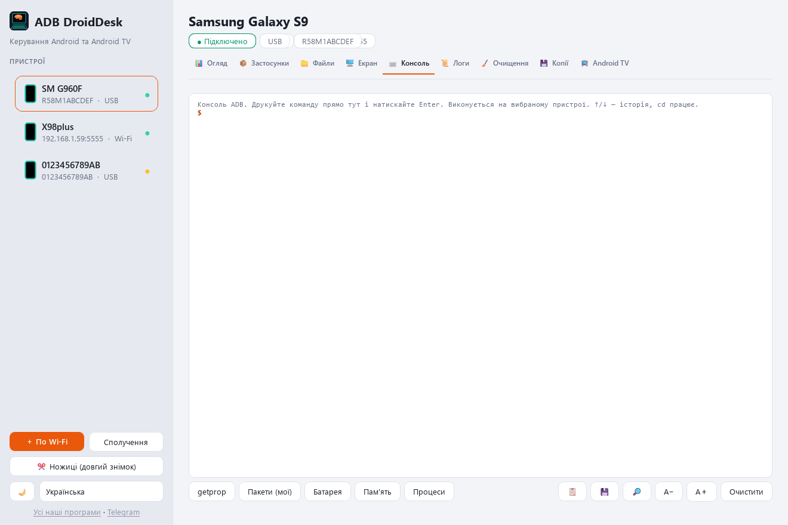

## Вимоги

Windows 10 або 11 (64-біт); телефон або приставка Android зі ввімкненим налагодженням (по USB або по мережі). Права адміністратора не обов’язкові, інтернет потрібен лише для пошуку в F-Droid і Google Play.

## Швидкий старт

1. Завантажте ADBDroidDesk-2.0.exe і запустіть; Windows запитає дозвіл (при відмові програма стане в теку користувача).
2. На пристрої: «Для розробників» → «Налагодження по USB» (приставка: «Налагодження по мережі»); підключіть кабель і дозвольте налагодження.
3. Приставка по Wi-Fi: «+ По Wi-Fi» → IP і порт, зазвичай 5555.
4. Android TV → «Встановлення»: перетягніть файли застосунків у вікно й натисніть «Встановити».

## Обмеження

- З F-Droid можна завантажити будь-яку версію; Google Play використовується лише для картинок банера, не для завантаження застосунків.
- Пониження версії на Android 12 і новіших та зміна підпису можливі лише з видаленням даних застосунку: система не дозволяє інакше.
- Підлаштування під ТВ змінює підпис застосунку: оновлення з магазину до такої копії не прийдуть; застосунки з кількох частин поки не підтримуються; керування пультом застосунку додати не можна.
- Перевірено на телефонах Android 10 і 15; на реальній приставці Android TV 14 служби спеціальних можливостей поки не перевірялися.
- Звук Android 10 йде через sndcpy; Android 11 і новіші передають звук самі.
- Інсталятор не підписаний сертифікатом видавця: Windows може показати попередження SmartScreen («Докладніше» → «Все одно виконати»).
- Програма неофіційна; всередині adb (Google) і scrcpy (Genymobile), ліцензія Apache-2.0.
