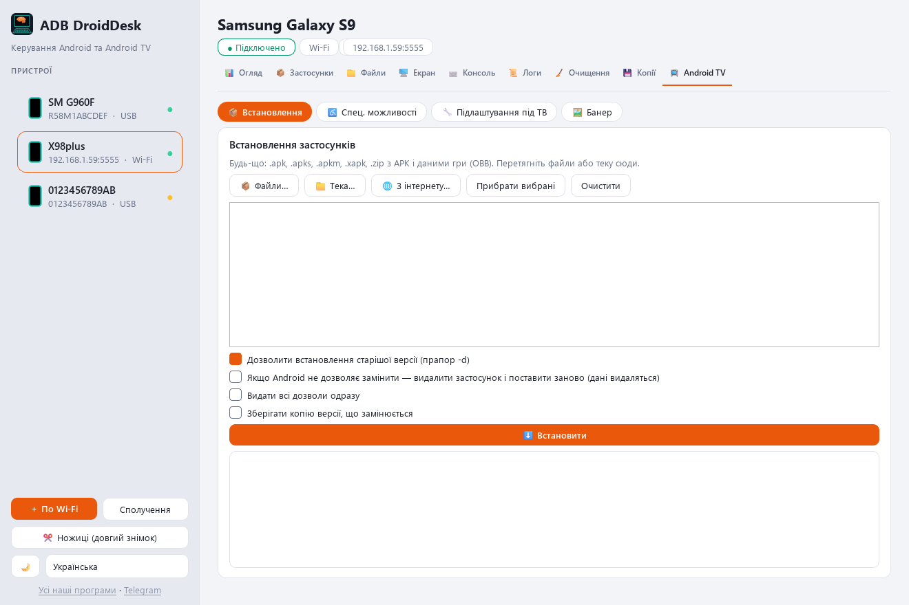
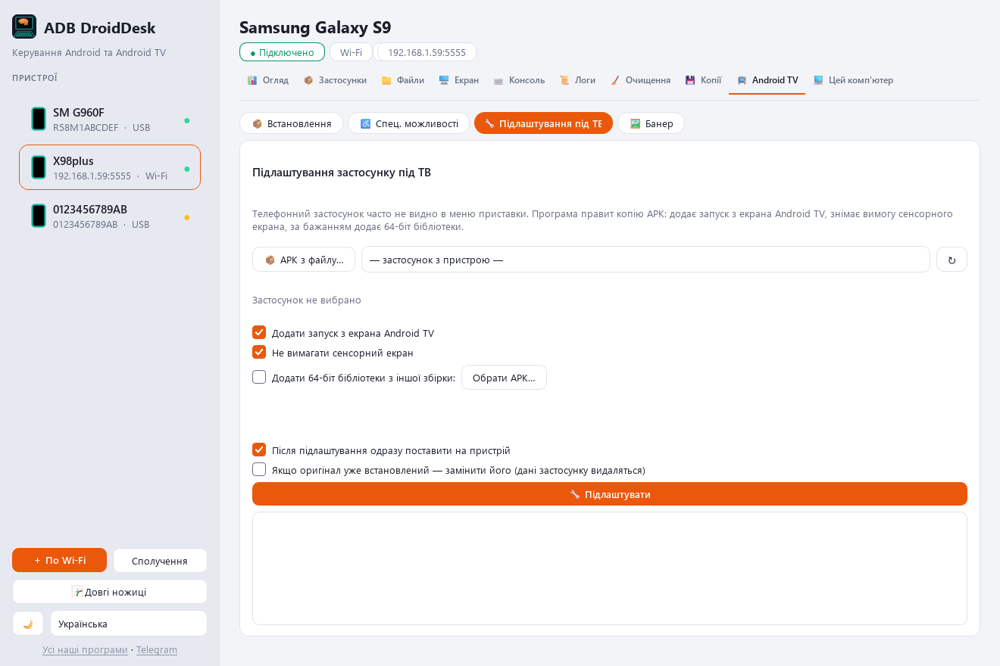
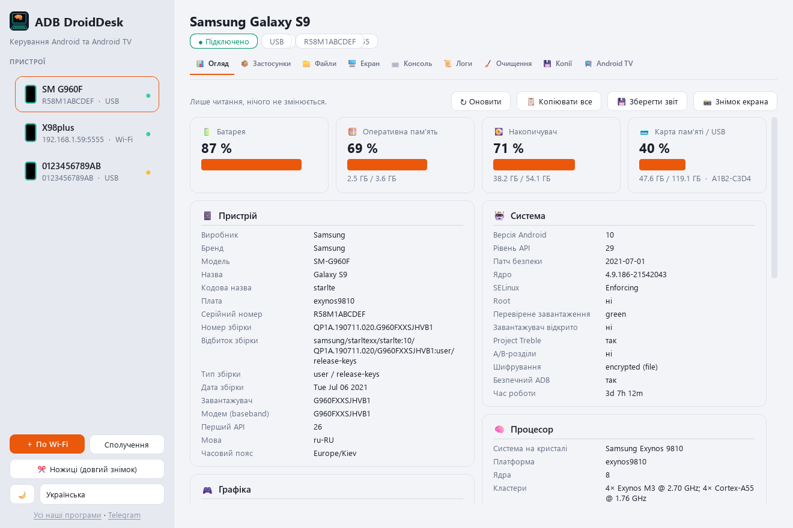
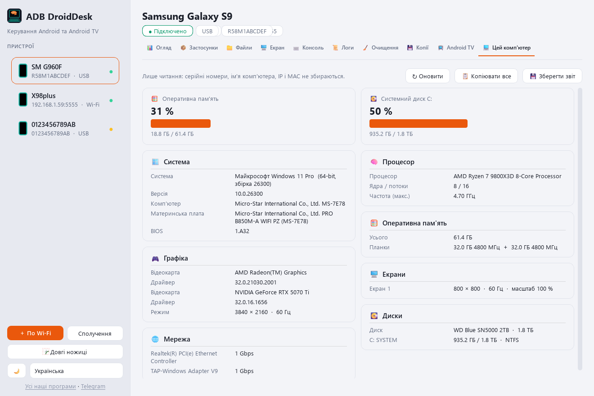
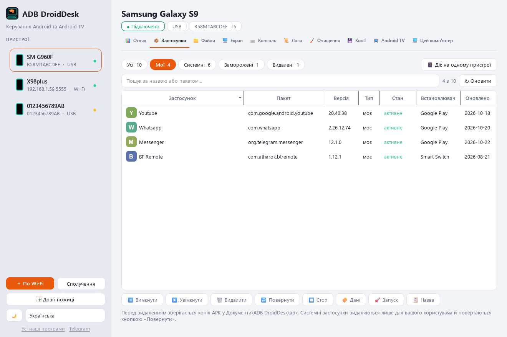
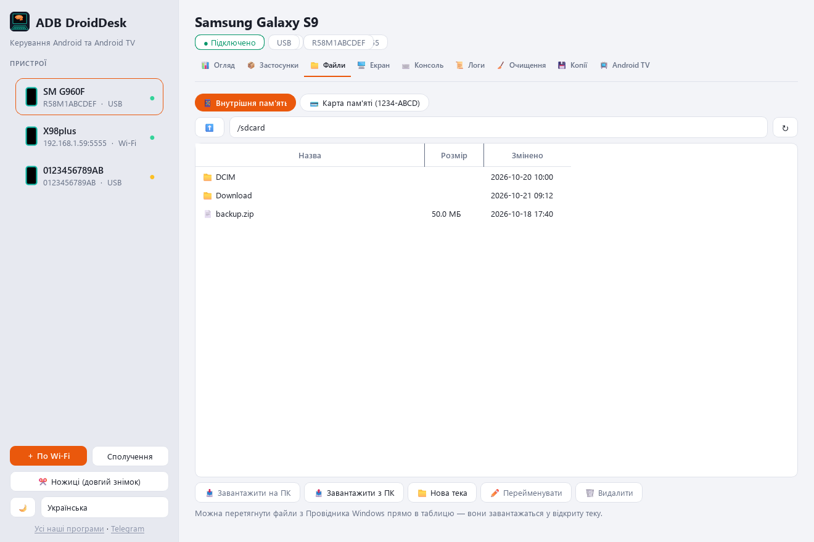
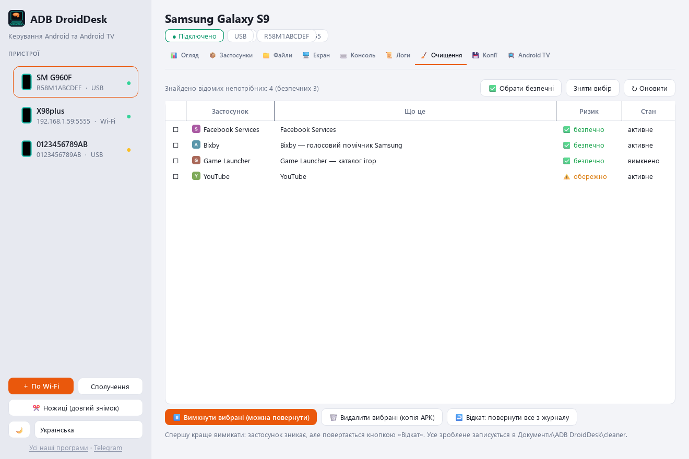
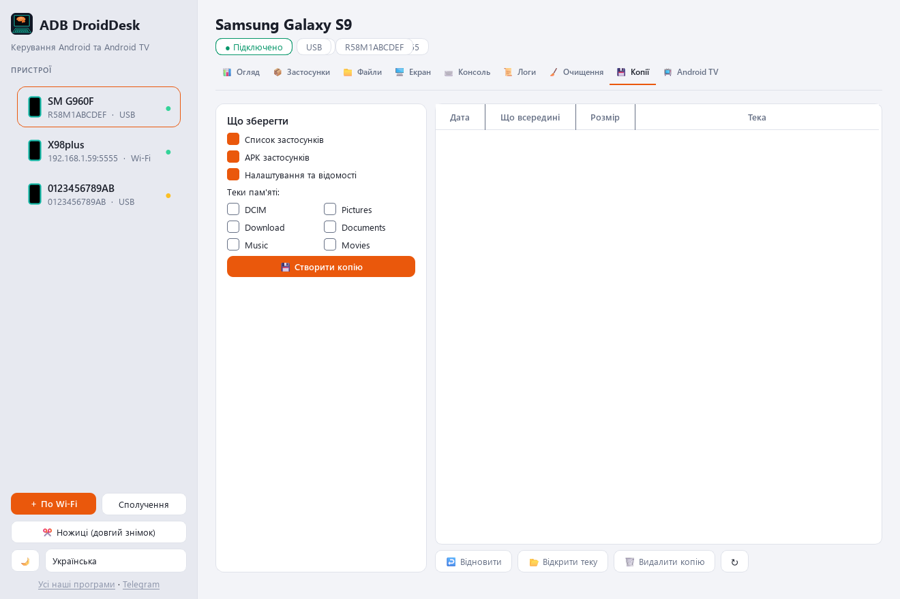
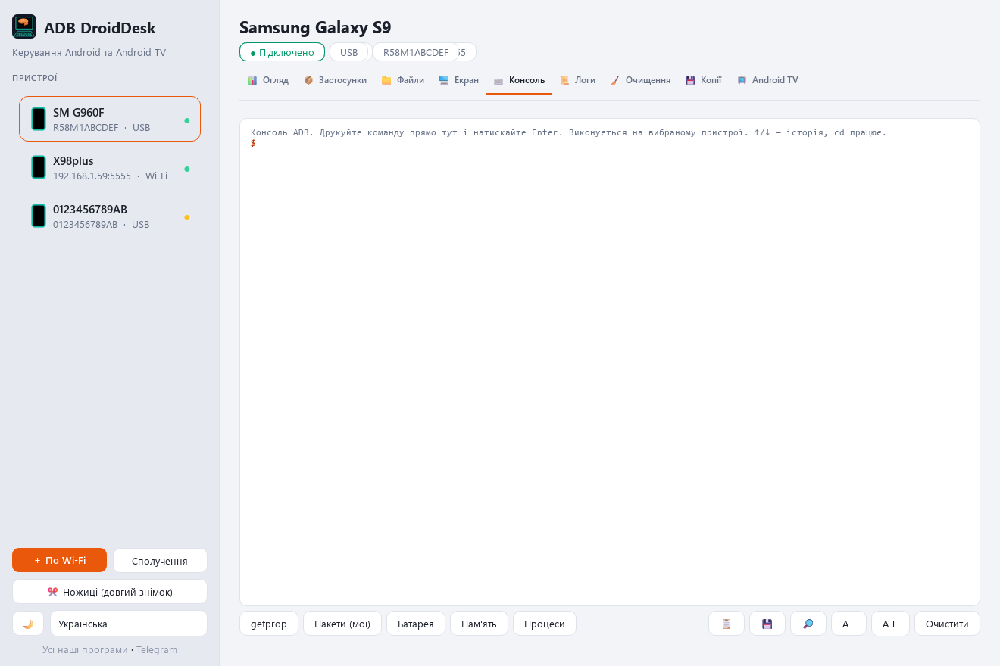

[English](README.md) · [Українська](README.uk.md) · [Русский](README.ru.md)

🌐 Усі наші програми: https://drugoj00.github.io/

Опис і скриншоти: https://drugoj00.github.io/phone-in-window-with-sound/adb-droiddesk.html

# ADB DroidDesk

Android і Android TV з комп’ютера: встановлення будь-яких застосунків, підлаштування під приставку, екран і файли іншого комп’ютера.

Безкоштовна програма для Windows для телефонів, планшетів і приставок Android TV по USB та Wi-Fi. Упор на Android TV: поставити на приставку будь-що без файлового менеджера, увімкнути служби спеціальних можливостей там, де їх блокує система, підлаштувати телефонний застосунок під ТВ, зробити банер. Плюс «Віддалений стіл»: екран іншого комп’ютера у вікні програми та провідник на дві панелі «цей комп’ютер ⇄ той комп’ютер». Решта — в одному вікні: екран зі звуком, застосунки, файли, консоль adb, очищення, копії. adb і scrcpy всередині, нічого окремо ставити не треба.

⭐ Якщо програма корисна, поставте зірку цьому репозиторію: це безкоштовно й допомагає іншим її знайти.

## Завантажити

**Версія 4.0.** [ADBDroidDesk-4.0.exe](https://github.com/drugoj00/adb-droiddesk/releases/latest) (Assets) · [Releases](https://github.com/drugoj00/adb-droiddesk/releases)

SHA-256: `811627f309e8755f5c5c67def80339cf82989f7473e3e146ba1c2746888b1d98`

## Що нового в 4.0

- Вкладка «Віддалений стіл»: екран іншого комп’ютера відкривається у вікні програми (вибір монітора, підгонка під вікно, буфер обміну); на тому комп’ютері треба підтвердити «Дозволити?».
- Поруч провідник на дві панелі «цей комп’ютер ⇄ той комп’ютер»: копіювання, перенесення, видалення, перейменування, F5–F8, Tab, перетягування, хід і скасування, вибір при збігу імен.
- «[Довгі ножиці](https://drugoj00.github.io/phone-in-window-with-sound/long-scissors.html)» винесено в окрему програму ([GitHub](https://github.com/drugoj00/long-scissors)): інсталятор став меншим.
- Знімок екрана пристрою зберігається в «Зображення\ADB DroidDesk» і копіюється в буфер обміну.
- Виправлено: окремих виправлень у цій версії немає.

## Можливості

### Android TV

- Встановлення на приставку без файлового менеджера: APK, APKS, APKM, XAPK, ZIP з даними гри (OBB).
- Джерела: файли, тека, перетягування, F-Droid з усіма старими версіями, посилання на файл.
- Потрібні частини пакета добираються під процесор, щільність екрана та мову пристрою.
- Встановлення старішої версії поверх новішої; де Android 12+ не дозволяє, заміна з копією та відкатом (дані видаляються).
- Старі застосунки на Android 14: обхід блокування «надто старий SDK».
- Спеціальні можливості: увімкнути службу та «обмежені налаштування» командами adb (Android 13–14).
- Підлаштування під ТВ: запуск з екрана Android TV, без вимоги сенсорного екрана, 64-біт бібліотеки з іншої збірки, підпис.
- Банери 320×180, 640×360, 1280×720; значок і обкладинки з Google Play.
- Пульт: стрілки, OK, Назад, Додому, гучність, введення тексту; на кілька пристроїв одразу.

### Звʼязок через інтернет

- Вкладка «Звʼязок»: пристрої мережі Tailscale, канал (прямий або через ретранслятор), підключення по ADB, перевірка каналу.
- Майстер: Tailscale на ПК і на Android-пристрої, вхід за ключем; надсилання файлу (Taildrop).
- Запрошення за кодом програми: підключити людину до своєї мережі, прийняти запрошення; ключі одноразові, на годину.
- Відеодзвінок без браузера: дзвінок людині зі списку, вікно «Дзвонить…», звук, динамік і камера вмикаються кнопками.
- Вкладка «Віддалений стіл»: екран іншого компʼютера у вікні програми (вибір монітора, підгонка під вікно, буфер обміну) і поруч провідник на дві панелі «цей компʼютер ⇄ той компʼютер» (F5–F8, Tab, перетягування, хід і скасування); на тому компʼютері треба підтвердити «Дозволити?». «Доступ до цього екрана» вмикається там.
- Автопідключення знайомих пристроїв домашньою мережею та через Tailscale.

### Усе інше

- Екран пристрою у вкладці: звук (Android 10 теж), запис відео, знімок, поворот, міні-вікно в кутку екрана.
- Застосунки: назви й значки, видалення та вимкнення системних з копією APK, дозволи, пакетні дії.
- Файли: дві панелі (ПК, пристрій, інший компʼютер), копіювання, перенесення, видалення, перетягування.
- Консоль adb з підсвічуванням та історією, logcat з фільтрами.
- Очищення за базою відомих непотрібних застосунків з відкатом; резервні копії застосунків.
- Огляд пристрою як у CPU-Z: процесор, пам’ять, батарея, екран, камери, датчики; вкладка «Цей комп’ютер» — те саме для самого Windows-комп’ютера.
- Кілька пристроїв одразу, USB і Wi-Fi, сполучення за кодом; значок біля годинника; українська, російська, англійська; світла й темна тема.

## Скриншоти

## Вимоги

Windows 10 або 11 (64-біт); телефон або приставка Android зі ввімкненим налагодженням (по USB або по мережі). Права адміністратора не обов’язкові, інтернет потрібен лише для пошуку в F-Droid і Google Play.

## Швидкий старт

1. Завантажте ADBDroidDesk-4.0.exe і запустіть; Windows запитає дозвіл (при відмові програма стане в теку користувача).
2. На пристрої: «Для розробників» → «Налагодження по USB» (приставка: «Налагодження по мережі»); підключіть кабель і дозвольте налагодження.
3. Приставка по Wi-Fi: «+ По Wi-Fi» → IP і порт, зазвичай 5555.
4. Android TV → «Встановлення»: перетягніть файли застосунків у вікно й натисніть «Встановити».

## Обмеження

- З F-Droid можна завантажити будь-яку версію; Google Play використовується лише для картинок банера, не для завантаження застосунків.
- Пониження версії на Android 12 і новіших та зміна підпису можливі лише з видаленням даних застосунку: система не дозволяє інакше.
- Підлаштування під ТВ змінює підпис застосунку: оновлення з магазину до такої копії не прийдуть; застосунки з кількох частин поки не підтримуються; керування пультом застосунку додати не можна.
- Перевірено на телефонах Android 10 і 15; на реальній приставці Android TV 14 служби спеціальних можливостей поки не перевірялися.
- Звук Android 10 йде через sndcpy; Android 11 і новіші передають звук самі.
- Інсталятор не підписаний сертифікатом видавця: Windows може показати попередження SmartScreen («Докладніше» → «Все одно виконати»).
- Програма неофіційна; всередині adb (Google) і scrcpy (Genymobile), ліцензія Apache-2.0.
- Відеодзвінок іде напряму між пристроями (потрібен Tailscale на обох або одна мережа, ретранслятора немає) і використовує WebView2 з Windows 10 і 11.
- «Віддалений стіл»: потрібен Tailscale на обох компʼютерах (або одна мережа), на іншому компʼютері має бути ввімкнено «Доступ до цього екрана» і введено його «Код програми»; без підтвердження «Дозволити?» екран не відкривається.
